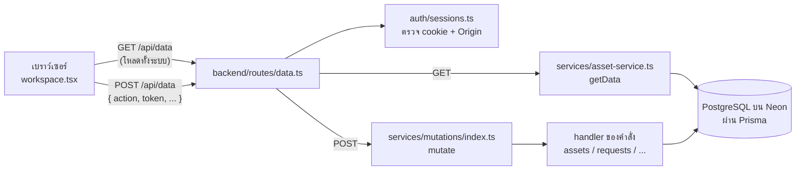

# โครงสร้างระบบ (Architecture)

เอกสารนี้อธิบายว่าระบบแบ่งเป็นส่วนไหนบ้าง ข้อมูลไหลอย่างไร และทำไมถึงออกแบบแบบนี้
อ่านคู่กับ [CONTRIBUTING.md](CONTRIBUTING.md) (วิธีทำงานกับโค้ด และขั้นตอนเพิ่มคำสั่งใหม่)

## 1. ภาพรวมในหนึ่งย่อหน้า

เว็บเป็น **หน้าเดียว** (Next.js + React) หลังล็อกอินจะโหลดข้อมูลทั้งระบบครั้งเดียวจาก `GET /api/data`
แล้วค้นหา/กรอง/เรียง/ทำกราฟในเครื่องผู้ใช้ทั้งหมด ทุกการบันทึกส่งไปที่ `POST /api/data` พร้อมชื่อคำสั่ง (`action`)
ฝั่งเซิร์ฟเวอร์ตรวจสิทธิ์ ตรวจข้อมูล แล้วเขียนฐานข้อมูล PostgreSQL ใน transaction เดียว จากนั้นหน้าเว็บโหลดข้อมูลใหม่



## 2. แผนที่โฟลเดอร์

```text
asset-manager/
├── frontend/                         หน้าเว็บ (Next.js App Router)
│   ├── app/                          จุดเริ่มของ Next.js: page.tsx → Workspace, api/* → ส่งต่อให้ backend
│   ├── features/                     หน้าจอแยกตามเรื่อง
│   │   ├── inventory/workspace.tsx   ★ ตัวควบคุมหลัก: เซสชัน โหลดข้อมูล บันทึก URL หน้าต่าง (modal)
│   │   ├── inventory/                ทะเบียน (registry-view, use-registry) ภาพรวม ฟอร์ม รายละเอียด QR แบ่งล็อต
│   │   ├── shell/                    เมนูข้าง กระดิ่งแจ้งเตือน รายการเมนู (navigation.ts)
│   │   ├── auth/                     หน้าเข้าสู่ระบบ
│   │   ├── imports/                  ตรวจและนำเข้า Excel
│   │   ├── requests/ stocktakes/     คำขอและการอนุมัติ / ตรวจนับประจำปี
│   │   ├── reports/ audit/ users/    รายงานค่าเสื่อม / ประวัติการทำงาน / ผู้ใช้และสิทธิ์
│   │   ├── exports/                  ส่งออก Excel และจัดทุน
│   │   └── operations/               สลับหน้า requests/stocktakes/reports/audit/users
│   ├── components/common.tsx         ตัวช่วยร่วม เช่น api() ที่เรียก /api/data, Badge, Pager
│   ├── components/ui/                ชิ้นส่วน UI สำเร็จรูป (shadcn) ไม่ค่อยต้องแก้
│   ├── services/excel-export.ts      สร้างไฟล์ Excel และหน้าพิมพ์รายงาน
│   └── utils/                        ตัวช่วยเล็ก ๆ (วันที่ไทย, รวม className)
│
├── backend/                          ฝั่งเซิร์ฟเวอร์ (รันใน process เดียวกับ Next.js)
│   ├── contracts/                    ★ กฎธุรกิจที่หน้าบ้านและหลังบ้านใช้ร่วมกัน (ไม่มีโค้ดฐานข้อมูล)
│   │   ├── domain.ts                 จุดรวมส่งออก — import ผ่านไฟล์นี้เสมอ
│   │   ├── domain/                   money, dates, depreciation, branches, asset-types,
│   │   │                             requests, assets, import-classify, constants, types
│   │   ├── models.ts                 รูปร่างข้อมูลที่ API ส่งกลับ (WorkspaceData)
│   │   └── html.ts, *-document.ts    escapeHtml และหน้าพิมพ์ (เอกสารอนุมัติ สติกเกอร์ QR)
│   ├── routes/                       รับคำขอ HTTP: data.ts (หลัก), asset-image.ts, source.ts
│   ├── auth/sessions.ts              ล็อกอิน เซสชัน 8 ชม. ตรวจ Origin จำกัดการเดารหัส
│   ├── services/
│   │   ├── asset-service.ts          getData (อ่าน) + ตัวช่วยตรวจข้อมูล/บันทึกประวัติ
│   │   ├── mutations/                ★ คำสั่งบันทึกทั้งหมด แยกไฟล์ตามเรื่อง (ดูข้อ 4)
│   │   └── asset-images.ts           รูปครุภัณฑ์ (ย่อ + ลบ EXIF ด้วย sharp)
│   ├── validation/                   Zod schema ตรวจข้อมูลที่ส่งมา
│   ├── db/client.ts                  เชื่อม PostgreSQL, json() แปลง BigInt, isWriteConflict()
│   ├── prisma/                       schema.prisma + migrations (ห้ามแก้ migration ที่ deploy แล้ว)
│   ├── storage/                      เก็บไฟล์ (Excel, รูป) ในตาราง stored_files
│   ├── debug/trace.ts                โหมดดูการทำงานหลังบ้าน (npm run dev:trace)
│   ├── scripts/                      seed บัญชี/ข้อมูลต้นฉบับ, สำรองแล้วล้างข้อมูล
│   └── tests/                        เทสต์อัตโนมัติ (npm test) + helpers/memory-db.ts
│
├── ARCHITECTURE.md  CONTRIBUTING.md  README.md  CLAUDE.md
└── eslint.config.mjs  .prettierrc.json  tsconfig.json  package.json  vercel.json
```

ชื่อย่อตอน import: `@/shared/*` = `backend/contracts/*` · `@/components/*` = `frontend/components/*` · `@/frontend/*`, `@/backend/*` = โฟลเดอร์นั้นตรง ๆ

## 3. การอ่านข้อมูล (GET /api/data)

1. `routes/data.ts` → `member()` ตรวจ cookie `ksu_session` (เก็บ hash ของ token ในตาราง `auth_sessions`)
2. `getData()` ใน `asset-service.ts` อ่านทุกตารางที่หน้าเว็บใช้พร้อมกัน (`Promise.all`) แล้วส่งกลับเป็น `WorkspaceData`
3. หน้าเว็บเก็บไว้ใน state ของ `workspace.tsx` แล้วส่งต่อให้ทุกหน้า การค้นหา กรอง กราฟ ทำในเครื่องผู้ใช้ทั้งหมด

ข้อจำกัดที่รู้แล้ว: ข้อมูลทั้งระบบส่งในคำตอบเดียว Vercel จำกัดคำตอบไว้ 4.5 MB (ประมาณ 4,500 รายการครุภัณฑ์)
ถ้าข้อมูลโตเกินนี้ต้องเปลี่ยนเป็นโหลดทีละหน้า (pagination) ฝั่งเซิร์ฟเวอร์

## 4. การบันทึกข้อมูล (POST /api/data)

ทุกคำสั่งเข้าทาง `mutate()` ใน `services/mutations/index.ts` ซึ่งทำงานเหมือนกันทุกคำสั่ง:

| ขั้น | ทำอะไร | ทำไม |
| --- | --- | --- |
| 1 | ตรวจ Origin + cookie (`routes/data.ts`) | กันเว็บอื่นแอบส่งคำสั่ง (CSRF) |
| 2 | เปิด transaction แบบ `Serializable` | ทุกขั้นสำเร็จพร้อมกันหรือย้อนกลับทั้งหมด และไม่มีใครแทรกกลางคัน |
| 3 | อ่านผู้ใช้สดจากฐานข้อมูล (`freshMember`) | สิทธิ์ที่ถูกถอนระหว่างใช้งานมีผลทันที |
| 4 | ดู `token` ในตาราง `operations` | กดบันทึกซ้ำ (เน็ตช้า) ได้ผลเดิม ไม่บันทึกซ้ำ (idempotency) |
| 5 | หา handler จาก "ตารางคำสั่ง" แล้วเรียก | แต่ละคำสั่งอยู่ในไฟล์ของเรื่องนั้น |
| 6 | เก็บผลลัพธ์คู่กับ token | ใช้ตอบซ้ำในขั้น 4 |
| 7 | ถ้าชนกับคนอื่นพร้อมกัน (Postgres 40001) ลองใหม่สูงสุด 5 รอบ | Serializable ยอมยกเลิกงานที่ชนกันแทนการให้ข้อมูลเพี้ยน |

ไฟล์ของแต่ละคำสั่งใน `services/mutations/`:

| ไฟล์ | action |
| --- | --- |
| `users.ts` | `user`, `workflow`, `password` (ทุกบทบาทเปลี่ยนรหัสผ่านของตัวเอง ต้องใส่รหัสเดิม แล้วออกจากระบบทุกเครื่อง) |
| `assets.ts` | `create`, `import`, `bulkEdit`, `edit`, `split`, `splitEach`, `repairComplete`, `void`, `restore` |
| `imports.ts`, `import-files.ts` | `batchImport`, `rowOverride`, `sourceDelete`, `sourceArchive` |
| `funds.ts` | `fundSave`, `fundDelete`, `fundAssign`, `fundUnassign` |
| `requests.ts` | `request`, `approve`, `reject` (ไม่อนุมัติ = คำขอสิ้นสุด), `cancelRequest` (ผู้ยื่นยกเลิกเองระหว่างรออนุมัติทุกขั้น), `requestMany` (ยื่นหลายรายการ ได้คำขอรายการละใบ), `approveMany` (อนุมัติที่เลือก ลงนามทีละใบ) — 2 ตัวหลังทุกใบสำเร็จพร้อมกันหรือไม่มีใบไหนเปลี่ยน ครั้งละไม่เกิน 100 ใบ |
| `stocktakes.ts` | `round`, `check`, `closeRound` |
| `helpers.ts` | ตัวช่วยร่วม เช่น `assertCodesFree` (รหัสห้ามซ้ำ), `loadEditableAsset` (ขั้นตรวจก่อนแก้ครุภัณฑ์) |

## 5. หลักการสำคัญที่ต้องรักษา

- **เงินเป็นสตางค์จำนวนเต็มเสมอ** (`BigInt` ในฐานข้อมูล, `number` ใน JSON) ใช้ `satang()` แปลงค่าที่กรอก, `money()` แสดงผล, `splitAmounts()` แบ่งยอด 2 ส่วน, `splitEvenly()` แบ่งยอดรายชิ้น ห้ามคิดเงินด้วยทศนิยม
- **version กันแก้ทับ**: ครุภัณฑ์และคำขอมีคอลัมน์ `version` หน้าเว็บส่ง version ที่เห็นมา ถ้าไม่ตรงตอบ 409 "ข้อมูลเปลี่ยนแล้ว"
- **ทุกการเปลี่ยนแปลงมีประวัติ**: เรียก `audit(tx, ...)` เก็บว่าใครทำ เมื่อไร ก่อน/หลัง และเหตุผล
- **ยอดเงินแก้ตรง ๆ ไม่ได้**: เปลี่ยนจำนวน/มูลค่าต้องผ่าน "แบ่งล็อต" ที่มีเหตุผลกำกับ
- **ทะเบียนเปลี่ยนเมื่ออนุมัติครบเท่านั้น**: คำขอโอนย้าย/ซ่อม/จำหน่าย ไม่แตะทะเบียนจนขั้นสุดท้ายอนุมัติ (head → deputy → dean)
- **ข้อความจากผู้ใช้ที่จะต่อเป็น HTML ต้องผ่าน `escapeHtml()`** (กัน XSS)
- **ไฟล์อยู่ในฐานข้อมูล**: รูปและ Excel เก็บเป็น bytea ในตาราง `stored_files` (Vercel ไม่มีดิสก์ถาวร)

## 6. บทบาทผู้ใช้

| บทบาท | ทำได้ |
| --- | --- |
| `staff` เจ้าหน้าที่พัสดุ | เพิ่ม/แก้/นำเข้าครุภัณฑ์ ยื่นคำขอ ยกเลิกคำขอของตัวเอง ตรวจนับ ยกเลิก/กู้คืนรายการที่บันทึกผิด |
| `head` หัวหน้าสาขาวิชา | อนุมัติขั้นที่ 1 เฉพาะครุภัณฑ์สาขาตัวเอง |
| `deputy` รองคณบดี | อนุมัติขั้นที่ 2 ทุกสาขา |
| `dean` คณบดี | อนุมัติขั้นสุดท้าย ทุกสาขา |
| `admin` ผู้ดูแลระบบ | จัดการบัญชี สายอนุมัติ และงานของเจ้าหน้าที่ · **อนุมัติคำขอไม่ได้** (แยกหน้าที่) |

ผู้อนุมัติ (`head` `deputy` `dean`) ไม่เห็นเมนูนำเข้า และดูหน้าตรวจนับได้อย่างเดียว (`canSeeView()` ใน `frontend/features/shell/navigation.ts` · เซิร์ฟเวอร์ตรวจซ้ำทุกคำสั่ง) · เลขบนเมนู กระดิ่ง และแท็บ "รอฉันอนุมัติ" นับจาก `pendingForUser()` ตัวเดียว

ทุกบทบาทห้ามอนุมัติคำขอที่ตัวเองยื่น สวิตช์ `ADMIN_APPROVES_ALL` ใน `contracts/domain/constants.ts` ต้องเป็น `false` (เปิดชั่วคราวเฉพาะวันสอบ)

## 7. สิ่งที่ยังค้าง (หนี้ทางเทคนิค)

- ไฟล์หน้าเว็บที่ยังยาว: `audit-view.tsx` (~1,280 บรรทัด), `excel-export.ts` (~1,000), `import-view.tsx`, `asset-form-modal.tsx`, `requests-view.tsx`
- `npm run lint` ผ่าน (0 error) แต่ยังมี warning 132: `any` 53, ตัวแปรไม่ได้ใช้ 26, `setState` ใน `useEffect` 26,
  dependency ของ hook ไม่ครบ 17, `` แทน `next/image` 10
- `getData()` ส่งข้อมูลทั้งระบบทุกครั้ง (ดูข้อ 3)
- การยื่นคำขอเพื่อออกเลขที่ อ่านคำขอทั้งตาราง และการตรวจรหัสซ้ำอ่านรหัสทั้งทะเบียน: ถูกต้องแต่ช้าลงเมื่อข้อมูลเยอะ
- ค่าเสื่อมนับตามวันจริง (365.25 วัน/ปี) รอยืนยันกับอาจารย์ว่าคณะต้องการนับแบบเดือนเต็มหรือไม่
